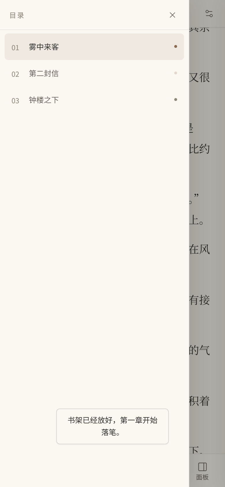

# 拾页

一个本地优先的长篇连载阅读器与写作台。正文、章节、人物和设定都存在本机，不经过第三方服务器；想接自己的模型时，再在设置里填 OpenAI 兼容接口即可。

同一套界面、字体和写作内核同时运行在 Windows 与 Android 上。桌面端用 Electron，手机端用 Capacitor 承载同一份 React 渲染层，业务逻辑直接复用，不存在两套功能各写一遍的问题。

<p>
  
  
  
  
</p>

## 下载与安装

在仓库的 `release` 目录（或 GitHub Releases）里选一个：

- **Windows 安装包** `拾页-1.0.0-安装包.exe`：常规安装，可选安装位置，会创建桌面和开始菜单快捷方式。
- **Windows 免安装版** `拾页-1.0.0-免安装.exe`：双击即用，不写注册表，适合放在 U 盘或临时使用。
- **Android** `拾页-1.0.0-Android.apk`：支持 Android 6.0（API 23）及以上，约 22 MB。

Windows 安装包没有购买代码签名证书，首次运行可能提示“未知发布者”，选择“更多信息 → 仍要运行”即可。Android APK 使用项目自己的发布密钥签名；首次安装需要在系统里允许当前文件管理器“安装未知应用”。

## 第一次使用

1. 打开后进入书架，点“新建”。
2. 写下题材、主角和故事核，选好每章字数，点“生成骨架”。
3. 在骨架页确认人物、开篇目标和前三章方向，点“开始写”。
4. 阅读器会先写当前章，并在后台预写后面两章。桌面端鼠标移到窗口顶部会浮出工具栏；手机端点一下正文即可显示或隐藏上下工具栏。

内置演示模型不需要联网，也不需要 Key，适合先看流程。要写得更长、更贴合自己的设定，请换用自己的模型。

## 手机端操作

界面沿用桌面端的纸色、宋体正文和布局比例，交互则按触屏重做：

- **沉浸阅读**：默认隐藏上下工具栏；轻点正文切换显示，滚动时自动收起。
- **底部章节栏**：目录、上一章、当前进度、下一章、写作面板，单手可达。
- **目录与面板**：目录从左滑出，写作面板从右滑出；点遮罩或按返回键关闭。
- **全屏面板**：设置、差异预览、确认框在手机上铺满屏幕，内容独立滚动。
- **选段改写**：长按选中文字后，工具条从底部升起；拖动选择柄不会误触关闭。
- **返回键层级**：先关弹层，再回书架，最后连按两次退出应用。
- **安全区适配**：刘海、挖孔、手势条和横屏同时参考 `safe-area-inset` 与原生窗口 insets，避免工具栏压住系统栏。

## 配置自己的模型

打开右上角设置 → 模型：

- **接口地址**：填 OpenAI 兼容的 `/v1` 地址，例如 `https://api.deepseek.com/v1`。
- **API Key**：只保存在本机设置里，不会上传。
- **模型名称**：例如 `deepseek-chat`。
- **测试连接**：看到“连接正常”即可。

本地模型（Ollama、LM Studio 等）也可以，接口地址填 `http://127.0.0.1:端口/v1`，Key 可以留空。Android 端允许明文 HTTP，以便连接同一局域网里的模型服务；如果只在手机上跑，也可以把地址指向电脑的局域网 IP。

> 手机上的模型请求由原生 OkHttp 通道发出，因此不受 WebView 跨域限制，流式输出可以逐字显示。

## 写作功能

- **零等待**：当前章写完后，后台会按缓冲章数继续预写；切到下一章时通常已经写好。
- **指令**：右侧面板可以给本章或后几章下指令，例如“让配角先发现线索”。三个节拍可以直接点进指令框。
- **选段改写**：在正文里选中一段，点工具条里的“改写”。先看差异预览，再决定应用或放弃；应用后可以随时从版本记录回滚。
- **版本**：每次重写前自动存档。右侧“版本”里可以比对和恢复。
- **目录**：桌面端是左上角非模态抽屉；手机端是左侧抽屉，点章节直接跳转。
- **导出**：书架里可以导出整本书为文本。Windows 上选择保存位置；Android 上通过系统分享面板保存到文件、网盘或发给其他应用。

## 数据与备份

**Windows**：默认数据目录是 `%APPDATA%\shiye-reader\data`，里面是 SQLite 数据库。设置里可以打开数据目录。卸载程序不会删除这个目录；需要彻底清理时手动删除。

**Android**：数据库放在应用私有目录，系统文件管理器无法直接浏览。设置 → 备份数据 会导出一份 `.db` 快照，并打开系统分享面板；建议定期保存到网盘或电脑。卸载应用会连同应用私有数据一起删除。

两端都不上传正文。只有在配置了外部模型并触发写作时，当前章节的上下文才会发送到你自己填写的接口。

## 开发

### 目录结构

```
src/main/        Electron 主进程：数据库、故事引擎、模型调用、导出、IPC
src/shared/      两端共享：类型、IPC 通道、设计 token、文本与解析工具
src/renderer/    React 渲染层：书架、设置、骨架、阅读器、目录、面板
android/         Capacitor 外壳与平台适配（不含桌面端代码的副本）
tests/           共享内核的 Vitest 测试
build/           桌面图标源文件与成品图标
```

Android 端通过 Vite alias 直接引用 `src/shared`、`src/main` 和 `src/renderer`。主进程中的数据库与故事引擎被移植到 WebView 内运行：

- **数据库**：`sql.js`（SQLite 的 WebAssembly 版本）保持同步 API，数据库字节节流写入应用私有文件，写入过程使用临时文件 + 重命名，并保留一份 `.bak`。
- **模型请求**：自写的 `NativeHttp` Capacitor 插件（Java + OkHttp）负责 SSE 流式请求，绕开 WebView 的 CORS 限制。
- **平台桥**：`android/src/platform/bridge.ts` 把桌面端的 IPC 通道映射为 `window.shiye`，渲染层不需要区分平台。

### Windows

```bash
npm install
npm run dev        # Electron 开发模式
npm run typecheck
npm test           # 60 个共享内核测试
npm run build
npm run dist       # 生成安装包和免安装版到 release
```

`npm run dist` 会生成安装包和免安装版到 `release`。如果下载 Electron 或打包工具很慢，可以先设置镜像：

```bash
export ELECTRON_MIRROR=https://npmmirror.com/mirrors/electron/
export ELECTRON_BUILDER_BINARIES_MIRROR=https://npmmirror.com/mirrors/electron-builder-binaries/
```

应用图标源文件在 `build/icon-src`，运行 `npm run icon` 会重新生成 `build/icon.ico`。

### Android

需要 Node 22+、JDK 21、Android SDK 35（build-tools 35.0.0）。

```bash
cd android
npm install

# 让 Gradle 找到 SDK；也可以改用 ANDROID_HOME 环境变量
# Windows: android/android/local.properties
# sdk.dir=C:/path/to/android-sdk

npm run sync          # 构建 Web 包并同步到原生工程
npm run apk:debug     # 生成 Debug APK
npm run apk:release   # 生成签名 Release APK（需要 keystore.properties）
```

产物位于 `android/android/app/build/outputs/apk/`。安装到已连接的设备：

```bash
adb install -r ../release/拾页-1.0.0-Android.apk
```

发布签名读取 `android/keystore.properties`（已被 `.gitignore` 排除）：

```properties
storeFile=shiye-release.jks
storePassword=……
keyAlias=shiye
keyPassword=……
```

`storeFile` 相对于 `android/` 目录。没有这个文件时，Release 构建仍是未签名 APK，适合 CI 验证，但无法直接安装。请妥善备份 keystore，丢失后无法覆盖安装升级。

图标与启动图由 `build/icon.png` 生成：

```bash
py -3 android/scripts/generate-assets.py
```

### 测试

```bash
npm run typecheck
npm test
```

Android 端另有一套基于 Chrome DevTools Protocol 的触屏冒烟测试，覆盖书架、骨架、阅读器、目录抽屉、写作面板、全屏设置、夜间主题、选段工具条、返回键、数据库持久化以及桌面端样式隔离：

```bash
cd android
npm run build
npx vite preview --port 5174
# 另开一个终端，用 Chrome/Edge 打开 http://127.0.0.1:5174/
# 启动参数加 --remote-debugging-port=9222
node scripts/smoke.mjs
```

截图会写入 `android/scripts/shots/`。

## 许可

代码以 MIT 许可证开源，见 [LICENSE](LICENSE)。内置字体、sql.js、Capacitor、OkHttp 等第三方组件的许可见 [THIRD_PARTY_NOTICES.md](THIRD_PARTY_NOTICES.md)。
