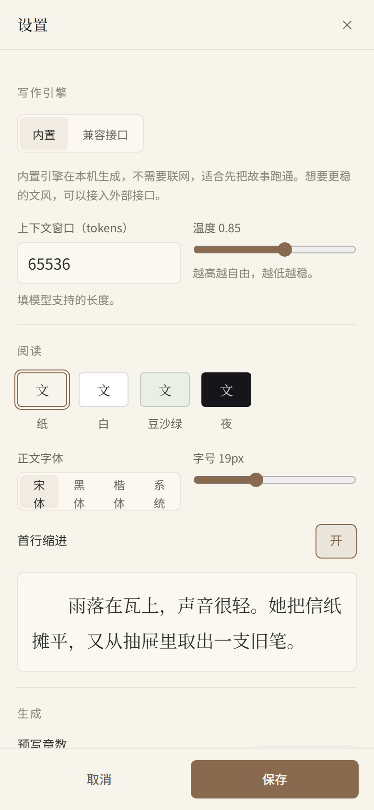

# 拾页

[](https://github.com/Zbraham/shiye-reader/actions/workflows/ci.yml)

一个本地优先的长篇连载阅读器与写作台。正文、章节、人物和设定都存在本机，不经过第三方服务器；想接自己的模型时，再在设置里填 OpenAI 兼容接口即可。

同一套界面、字体和写作内核同时运行在 Windows 与 Android 上。桌面端用 Electron，手机端用 Capacitor 承载同一份 React 渲染层，业务逻辑直接复用，不存在两套功能各写一遍的问题。

源码与发布页：https://github.com/Zbraham/shiye-reader

<p>
  
  
  
  
</p>

## 下载与安装

在仓库的 `release` 目录（或 GitHub Releases）里选一个。GitHub Releases 上的文件名使用 ASCII，本地 `release` 目录保留中文名：

- **Windows 安装包** `shiye-1.2.1-setup.exe`（本地：`拾页-1.2.1-安装包.exe`）：常规安装，可选安装位置，会创建桌面和开始菜单快捷方式。
- **Windows 免安装版** `shiye-1.2.1-portable.exe`（本地：`拾页-1.2.1-免安装.exe`）：双击即用，不写注册表，适合放在 U 盘或临时使用。
- **Android** `shiye-1.2.1-android.apk`（本地：`拾页-1.2.1-Android.apk`）：支持 Android 6.0（API 23）及以上；校验值见 `shiye-1.2.1-sha256.txt`。

Windows 安装包没有购买代码签名证书，首次运行可能提示“未知发布者”，选择“更多信息 → 仍要运行”即可。Android APK 使用项目自己的发布密钥签名；首次安装需要在系统里允许当前文件管理器“安装未知应用”。

## 功能总览

### 导入与书架

- **多种格式**：TXT、Markdown、HTML、EPUB、DOCX、FB2、RTF，以及打包了文本的 ZIP。自动识别 UTF-8 / UTF-16 / GBK，按中文章节标题、卷名和 Markdown 标题分章；没有标题时按段落长度兜底切分。
- **EPUB 完整阅读**：按 OPF spine 顺序取正文，保留插图、表格、注音和基本排版；图片内联到本地数据库，阅读时不联网。
- **批量与文件夹**：一次最多 20 个文件，支持整个文件夹导入、拖拽文件，也可以粘贴一个直链或浏览 OPDS 书目下载。
- **导入预览可改**：导入前可以改书名、作者、系列、出版社、语言、标签、简介、封面，逐章翻看并直接修标题和正文，确认后再入库。解析只在本机进行，导入过程不调用 AI。
- **书架管理**：封面、评分、阅读状态（想读 / 在读 / 读完 / 弃读）、自定义书单、按书名/作者/系列/标签搜索、按来源/状态/书单筛选、按最近阅读/书名/字数排序。
- **批量操作**：多选后批量删除或加入书单；一键比对重复书名，选择要清理的副本。
- **元数据与封面**：书名、作者、系列、出版社、语言、标签、简介、评分、阅读状态都能在书目信息里修改；封面可在本地压缩后保存。

### 阅读

- **两种翻页方式**：上下滚动，或左右分页（CSS 多栏 + 滚动吸附）。分页模式下可用左右方向键、PageUp/PageDown 或屏幕两侧按钮翻页。
- **排版控制**：宋体 / 黑体 / 楷体 / 系统字体，字号、行高、字距、段距、版心宽度、两端对齐都可调；阅读设置里实时预览。
- **主题与亮度**：纸色、纯白、豆沙绿、夜间四套主题；亮度滑块只压暗阅读区，不遮挡操作。
- **竖排与简繁**：支持 `writing-mode: vertical-rl` 竖排（从右向左翻页）和简体/繁体实时转换，只改变显示，不改动原文。
- **多级目录**：卷、章两级目录，点卷名折叠/展开，长篇也不会一次铺满屏幕。
- **书签**：在当前阅读位置添加书签，书签列表可以跳转和删除。
- **全文搜索**：本书或整个书架搜索，结果带上下文高亮；跨书结果会先打开对应书籍，再定位到命中位置。
- **详细进度**：章内百分比、全书百分比、当前章/总章数和预计剩余阅读时间；底部进度条按全书字数计算。
- **阅读统计**：最近 30 天的阅读时长柱状图、连续阅读天数、累计时长和阅读最多的书。
- **位置恢复**：退出、切章、换书、切换分页/竖排模式后都会回到原来的位置；刷新时保留章内比例而不是绝对像素。
- **相邻章预载**：读完当前章时后台预取前后章正文，翻到下一章几乎没有等待。
- **沉浸模式**：隐藏上下工具栏和进度条，只留正文；点右上角退出或按 Esc。
- **手机手势**：左右滑动切章/翻页，轻点正文显示或隐藏工具栏，滚动时自动收起。

### 写作与续写

- **一句话起书**：填写题材、主角和故事核，生成骨架与前三章方向，再开始写。
- **零等待**：当前章写完后，后台按缓冲章数（1–3 章）继续预写；切到下一章时通常已经写好。
- **指令与节拍**：给本章、后续 3 章、本卷或全书下指令；三个节拍可以直接点进方向框。
- **选段改写**：选中一段 → 改写 / 扩写 / 精简 / 换语气 / 续写，先看差异预览（绿增红删），再逐段采纳或放弃；每次重写前自动存档，版本记录里可以比对和恢复。
- **导入书改后续**：读到自己想改的地方，在章末点「从这里改后续」，或选中一段后点「改后续」；可选保留本章 / 连同本章 / 保留到段末。给一句方向，就按原文的人称与语气续写 3 章，写完还能接着再来 3 章，旧稿先存进版本历史。
- **模型自由**：填 OpenAI 兼容的 `/v1` 地址——DeepSeek、通义千问、Kimi、Ollama、LM Studio 都行，Key 只存本机；手机端由原生 OkHttp 发出请求，流式输出逐字显示。
- **离线演示模型**：不填任何模型也能用内置演示模型把流程走完。

### 问答与全书洞察

- **原文问答**：先在本机按段落检索相关原文，再交给模型归纳，回答附带章节与原文摘录；可以限制「不读当前章之后」避免剧透。离线模式下直接用原文摘录回答。
- **时间线**：把已读章节整理成按故事时间排列的事件，标注参与人物。
- **连贯性检查**：时间、人名、能力、伏笔、视角、逻辑六类疑点，可逐条忽略或恢复。
- **人物所知**：记录每个角色在第几章知道了什么，避免角色开天眼。
- **伏笔追踪**：记录埋设章、回收章和当前状态，可以手动标为已回收或忽略。
- **阅读侧边栏**：写作、编辑、后续、问答、洞察五个页签共用右侧面板；手机上从右侧滑出，桌面端与正文并排。

### 同步与导出

- **多设备同步**：设置里填 WebDAV 地址（坚果云、Nextcloud 等）、账号和备份文件名，手动点同步即可。合并时保留本机阅读位置，书签、书单和阅读记录按最新合并。
- **导出**：整本导出 TXT、Markdown、EPUB、DOCX；桌面端另外支持 PDF（通过 Chromium 打印）。Android 导出后打开系统分享面板，可保存到文件、网盘或发给其他应用。
- **数据备份**：Android 设置 → 备份数据会导出一份 `.db` 快照并打开系统分享面板。

## 第一次使用

1. 打开后进入书架，点“新建”，或点“导入小说”读一本已有的书。
2. 新建：写下题材、主角和故事核，选好每章字数，点“生成骨架”。在骨架页确认人物、开篇目标和前三章方向，点“开始写”。
3. 阅读器会先写当前章，并在后台预写后面两章。桌面端鼠标移到窗口顶部会浮出工具栏；手机端点一下正文即可显示或隐藏上下工具栏。

## 手机端操作

界面沿用桌面端的纸色、宋体正文和布局比例，交互则按触屏重做：

- **沉浸阅读**：默认隐藏上下工具栏；轻点正文切换显示，滚动时自动收起。
- **底部章节栏**：目录、上一章、当前进度、下一章、写作面板，单手可达。
- **目录与面板**：目录从左滑出，侧边面板从右滑出；点遮罩或按返回键关闭。
- **全屏面板**：设置、差异预览、确认框在手机上铺满屏幕，内容独立滚动。
- **选段改写**：长按选中文字后，工具条从底部升起；拖动选择柄不会误触关闭。
- **返回键层级**：先关弹层，再回书架，最后连按两次退出应用。
- **安全区适配**：刘海、挖孔、手势条和横屏同时参考 `safe-area-inset` 与原生窗口 insets，避免工具栏压住系统栏。

## 配置自己的模型

打开右上角设置 → 模型：

- **接口地址**：填 OpenAI 兼容的 `/v1` 地址，例如 `https://api.deepseek.com/v1`。
- **API Key**：只保存在本机设置里，不会上传。
- **模型名称**：例如 `deepseek-chat`。
- **测试连接**：看到“连接正常”即可。

本地模型（Ollama、LM Studio 等）也可以，接口地址填 `http://127.0.0.1:端口/v1`，Key 可以留空。Android 端允许明文 HTTP，以便连接同一局域网里的模型服务；如果只在手机上跑，也可以把地址指向电脑的局域网 IP。

> 手机上的模型请求由原生 OkHttp 通道发出，因此不受 WebView 跨域限制，流式输出可以逐字显示。

## 数据与备份

**Windows**：默认数据目录是 `%APPDATA%\shiye-reader\data`，里面是 SQLite 数据库。设置里可以打开数据目录。卸载程序不会删除这个目录；需要彻底清理时手动删除。

**Android**：数据库放在应用私有目录，系统文件管理器无法直接浏览。设置 → 备份数据 会导出一份 `.db` 快照，并打开系统分享面板；建议定期保存到网盘或电脑。卸载应用会连同应用私有数据一起删除。

两端都不上传正文。只有在配置了外部模型并触发写作、问答或全书洞察时，相关章节的上下文才会发送到你自己填写的接口；配置 WebDAV 同步时，备份文件会上传到你自己填写的服务器。

## 开发

### 目录结构

```
src/main/        Electron 主进程：数据库、故事引擎、模型调用、导入导出、同步、IPC
src/shared/      两端共享：类型、IPC 通道、设计 token、文本/解析/导出工具
src/renderer/    React 渲染层：书架、设置、骨架、阅读器、目录、侧边面板
android/         Capacitor 外壳与平台适配（不含桌面端代码的副本）
tests/           共享内核的 Vitest 测试
build/           桌面图标源文件与成品图标
```

Android 端通过 Vite alias 直接引用 `src/shared`、`src/main` 和 `src/renderer`。主进程中的数据库与故事引擎被移植到 WebView 内运行：

- **数据库**：`sql.js`（SQLite 的 WebAssembly 版本）保持同步 API，数据库字节节流写入应用私有文件，写入过程使用临时文件 + 重命名，并保留一份 `.bak`。
- **模型请求**：自写的 `NativeHttp` Capacitor 插件（Java + OkHttp）负责 SSE 流式请求，绕开 WebView 的 CORS 限制。
- **平台桥**：`android/src/platform/bridge.ts` 把桌面端的 IPC 通道映射为 `window.shiye`，渲染层不需要区分平台。

### Windows

```bash
npm install
npm run dev        # Electron 开发模式
npm run typecheck
npm test           # 127 个共享内核测试
npm run build
npm run dist       # 生成安装包和免安装版到 release
```

`npm run dist` 会生成安装包和免安装版到 `release`。如果下载 Electron 或打包工具很慢，可以先设置镜像：

```bash
export ELECTRON_MIRROR=https://npmmirror.com/mirrors/electron/
export ELECTRON_BUILDER_BINARIES_MIRROR=https://npmmirror.com/mirrors/electron-builder-binaries/
```

应用图标源文件在 `build/icon-src`，运行 `npm run icon` 会重新生成 `build/icon.ico`。

### Android

需要 Node 22+、JDK 21、Android SDK 35（build-tools 35.0.0）。

```bash
# 在仓库根目录安装共享渲染层依赖
npm install

cd android
npm install            # Android 外壳依赖

# 让 Gradle 找到 SDK；也可以改用 ANDROID_HOME 环境变量
# Windows: android/android/local.properties
# sdk.dir=C:/path/to/android-sdk

npm run sync          # 构建 Web 包并同步到原生工程
npm run apk:debug     # 生成 Debug APK
npm run apk:release   # 生成签名 Release APK（需要 keystore.properties）
```

产物位于 `android/android/app/build/outputs/apk/`。安装到已连接的设备：

```bash
adb install -r ../release/拾页-1.2.1-Android.apk
```

发布签名读取 `android/keystore.properties`（已被 `.gitignore` 排除）：

```properties
storeFile=shiye-release.jks
storePassword=……
keyAlias=shiye
keyPassword=……
```

`storeFile` 相对于 `android/` 目录。没有这个文件时，Release 构建仍是未签名 APK，适合 CI 验证，但无法直接安装。请妥善备份 keystore，丢失后无法覆盖安装升级。

图标与启动图由 `build/icon.png` 生成：

```bash
py -3 android/scripts/generate-assets.py
```

### 测试

```bash
npm run typecheck
npm test
```

Android 端另有一套基于 Chrome DevTools Protocol 的触屏冒烟测试，覆盖书架、骨架、阅读器、目录抽屉、写作面板、全屏设置、夜间主题、选段工具条、返回键、数据库持久化以及桌面端样式隔离：

```bash
cd android
npm run build
npx vite preview --port 5174
# 另开一个终端，用 Chrome/Edge 打开 http://127.0.0.1:5174/
# 启动参数加 --remote-debugging-port=9222
node scripts/smoke.mjs
```

截图会写入 `android/scripts/shots/`。

## 已知边界

- 导入上限：2000 章、800 万正文字符、单个源文件 20 MB；超出会明确报错，不静默截断。
- EPUB 只支持未加密、非 ZIP64、stored/deflate 压缩；DRM、ZIP64、未知压缩会直接报错。
- 极旧的 Android WebView 如果没有 `DecompressionStream('deflate-raw')`，EPUB 解压会提示改用 TXT；TXT / Markdown 不受影响。
- PDF 导出只在桌面端可用。迷你悬浮窗、系统级文件关联（双击 .txt 用拾页打开）暂未实现。
- 全书问答与洞察需要在线模型；离线模式只能用原文摘录回答，不能归纳。

## 许可

代码以 MIT 许可证开源，见 [LICENSE](LICENSE)。内置字体、sql.js、Capacitor、OkHttp 等第三方组件的许可见 [THIRD_PARTY_NOTICES.md](THIRD_PARTY_NOTICES.md)。
